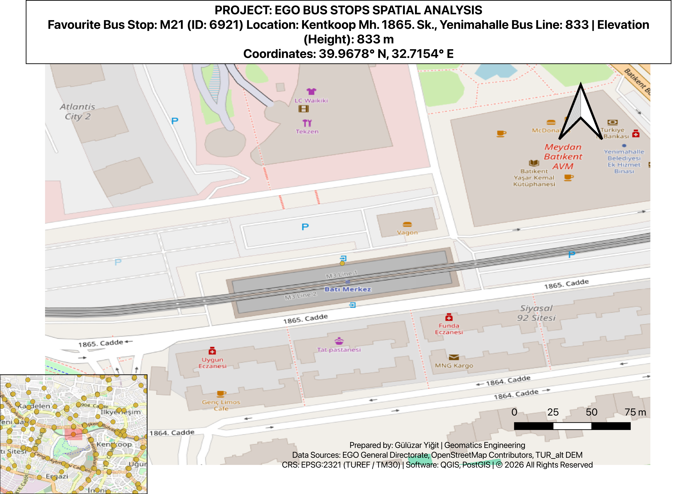

# EGO Public Transit Spatial Analysis & Network Routing

An end-to-end spatial data engineering and cartographic analysis project processing OpenStreetMap road networks, Ankara EGO bus stop geometries, and high-resolution Digital Elevation Models. Built with PostgreSQL/PostGIS, pgRouting, and QGIS.

---
## Cartographic Layout


---

## Project Overview

This study addresses urban transit accessibility, geometric spatial association, and terrain modeling across Ankara, Turkey. The project evaluates Euclidean versus topological network distances, establishes dynamic buffer relationships between bus stops and secondary road networks, and incorporates continuous terrain elevation data into discrete vector assets.

---

## Technical Competencies

* Spatial Database Architecture (PostGIS): Metric reprojections (EPSG:2321 - TUREF / TM30), distance matrix calculations, vector buffering, and geometric intersection joints.
* Network Graph Routing (pgRouting): Road network topology configuration, node/edge cost modeling, and Dijkstra-based shortest path routing.
* Complex SQL Analytics: Multi-tiered Common Table Expressions (CTEs), window-based record deduplication (DISTINCT ON), and road-level stop frequency aggregation.
* Surface Interpolation: Point-raster vertical sampling from high-resolution DEM grids to vector attribute schemas.
* Cartographic Production: Dual-scale inset layout design, dynamic overview frame linking, cartographic balancing, and metadata governance.

---

## Methodology & Engineering Steps

### Coordinate System Standardization & Metric Projection
To ensure measurement accuracy in real-world meters, all layers originally defined in WGS 84 (EPSG:4326) were transformed to the projected metric coordinate system TUREF / TM30 (EPSG:2321). Spatial boundaries were verified against test polygons using topological containment.

### Pedestrian Access: Euclidean vs. Network Routing
Accessibility from target coordinates to the nearest EGO transit stop was analyzed through two distinct paradigms:
* Euclidean Metric Proximity: Direct straight-line distance computed via spatial distance functions (25.10 m).
* Graph-Based Topological Routing: Utilizing pgRouting and Dijkstra's algorithm across secondary road linestrings to simulate realistic pedestrian travel along road corridors (52.34 m).

### Spatial Buffering & Overlap Resolution
* Proximity Buffering: A 10-meter metric buffer zone was generated around transit stops to capture adjacent secondary road centerlines.
* Multi-Road Conflict Resolution: To resolve stops lying within the buffer threshold of multiple intersecting or dual-carriageway segments, an analytical CTE filtering pipeline was constructed. By sorting minimum geometric distances per stop identity, each stop was unambiguously assigned to a single dominant road feature.
* Aggregation: Derived road-level transit stop densities exported as tabular reporting formats.

### DEM Surface Sampling
Topographic elevation was derived for all transit features using the TUR_alt digital elevation model. The vector layer schema was extended with an integer elevation attribute (height) populated through raster surface sampling at point coordinates.

### Inset Cartographic Map Layout
A multi-scale print layout was designed focusing on the M21 transit point (ID: 6921, Yenimahalle):
* Focal Detail Frame: 1:1,300 scale view showing building footprints, metro connectivity, and immediate road access.
* Overview Inset Frame: Metropolitan-scale orientation map with a dynamic extent frame showing the focal map boundary.
* Cartographic Standard Elements: Metric scale bar (75 m intervals), north arrow, complete coordinate labels, and full provenance metadata.

---

## Tech Stack & Data Sources

| Tool / Source | Purpose |
| :--- | :--- |
| PostgreSQL / PostGIS | Spatial querying, spatial indexing, metric transformations |
| pgRouting | Shortest path analysis via Dijkstra graph routing |
| QGIS Desktop | Cartographic production, Print Layout, raster interpolation |
| EGO General Directorate | Public transit stop spatial features |
| OpenStreetMap Contributors | Secondary road and urban infrastructure vector datasets |
| TUR_alt DEM | Topographic elevation raster layer |

---

## Repository Structure

```text
├── data/
│   ├── part3_3_bus_stops_secondary_roads_matching.csv
│   └── part3_4_bus_stop_distribution_on_roads.csv
├── part5_fav_bus_stop.pdf
├── part5_fav_bus_stop.png
├── README.md
└── LICENSE

License & Usage
Copyright 2026 Gulumzar Yigit. All Rights Reserved.
All cartographic layouts, analytical workflows, and documentation in this repository are personal portfolio deliverables. Unauthorized reproduction or direct duplication of these outputs without attribution is prohibited.